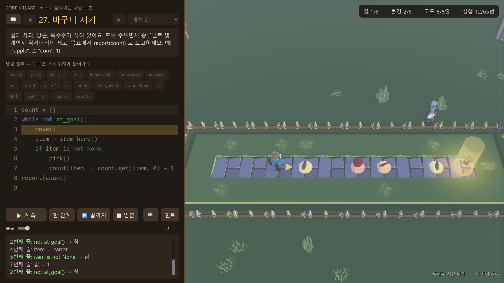
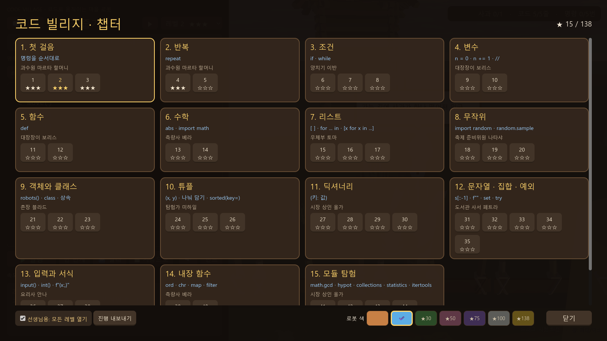

# 게임 개발: 교육용 코딩 게임 「코드 빌리지」

## 세부 운영 내용

Godot 엔진과 AI 코딩 도구를 활용하여 학생이 파이썬 코드로 3D 마을의 로봇을 움직이며 프로그래밍을 익히는 교육용 코딩 게임 「코드 빌리지」를 개발함.

## 공동 연구 및 실천 과제 실행 결과

기초 명령부터 반복·조건·함수·클래스·딕셔너리·모듈까지 15챕터 46레벨과 별 3개 평가(클리어·코드 길이·실행 효율), 학습 진행 기록 내보내기 기능을 갖춘 수업 적용용 프로토타입을 완성함.

## 게임 화면

*레벨 실행 화면. 딕셔너리로 수확물을 세는 코드가 한 줄씩 실행되며 로봇이 움직인다.*

*챕터 선택 화면. 15개 챕터의 레벨별 별 획득 현황과 로봇 색 보상, 진행 내보내기 기능.*
